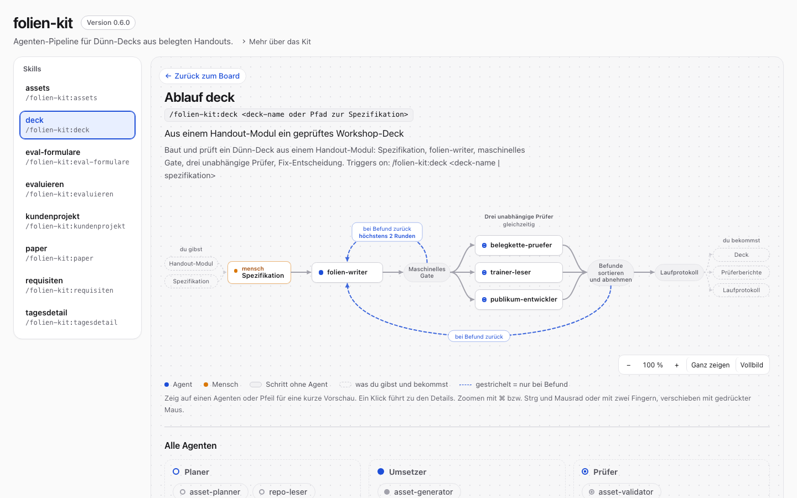

# atlas-kit

atlas-kit macht aus einem Claude-Code-Kit (einem Plugin mit Skills und Agenten, also einem Ordner mit `.claude-plugin/plugin.json`) oder aus einem Projekt, in dem Claude eigene Skills oder Agenten unter `.claude/` hat, eine Seite. Sie zeigt, welche Skills und Agenten es gibt und wie ihre Abläufe laufen. Das klappt für deine eigenen Kits und Projekte und für jedes andere Kit, das du installiert oder als Ordner vorliegen hast. Hat ein Kit keine eigenen Angaben zu seinen Abläufen, liest Claude sie aus den Beschreibungen heraus, jeden Schritt mit seiner Belegzeile. Das Kit oder Projekt wird dabei nur gelesen, nie verändert.



## Installation

```
/plugin marketplace add MakeNative/atlas-kit
/plugin install atlas@atlas-kit
```

Mehr musst du nicht einrichten. Du brauchst Claude Code und Python 3.9 oder neuer. Beim ersten Aufruf richtet atlas-kit sein Hilfsprogramm zum Lesen ein: eine eigene Python-Umgebung mit PyYAML im Datenordner, den Claude Code dem Plugin gibt, nichts ins System-Python. Das dauert etwa eine Minute und braucht einmal Internet, danach nicht mehr. An deinem System ändert es nichts.

atlas-kit ist getestet auf macOS. Linux und Windows sollten gehen, sind aber noch nicht ausprobiert.

## Benutzung

Am einfachsten ist `/atlas:init`: einlesen, Abläufe ableiten, Seite bauen und öffnen, alles in einem Rutsch. Daneben gibt es drei einzelne Befehle für die Teilschritte: `/atlas:scan`, `/atlas:analyse` und `/atlas:render`. Alle vier nehmen dieselbe Angabe, welches Kit oder Projekt gemeint ist:

- Ohne Angabe nimmt atlas-kit das Kit oder Projekt in dem Ordner, in dem du gerade arbeitest.
- Mit einem Ordner nimmt es das Kit oder Projekt dort, zum Beispiel `/atlas:init ~/mein-kit`.
- Mit einem Namen nimmt es das Kit, das bei dir unter diesem Namen installiert ist, so wie es der Befehl /plugin zeigt, zum Beispiel `/atlas:scan folien-kit`. Gibt es den Namen in mehreren Marktplätzen, hängst du den Marktplatz mit @ an, also `<name>@<marktplatz>`, zum Beispiel `/atlas:scan recherche-kit@recherche-agent-kit`.

Ein Projekt ist ein normaler Ordner, in dem Claude eigene Skills unter `.claude/skills` oder eigene Agenten unter `.claude/agents` hat. Die Seite heißt dann wie der Ordner. Gelesen werden auch die Hooks aus `.claude/settings.json`.

Bei jedem Aufruf fragt Claude Code dich, ob es das Skript von atlas-kit ausführen darf.

### `/atlas:init` macht alles in einem Rutsch

```
/atlas:init
/atlas:init ~/mein-kit
/atlas:init folien-kit
```

atlas-kit liest das Kit ein und schaut, welche Skills und Agenten keine eigenen Atlas-Angaben haben. Für diese liest Claude die Abläufe und Rollen aus den Beschreibungen heraus. Das nutzt deine laufende Claude-Sitzung, ohne eigenen Zugang und ohne zusätzliche Kosten, und dauert je nach Größe des Kits einige Minuten. atlas-kit gibt Claude die Skills und Agenten in Durchgängen von höchstens acht Skills und zwanzig Agenten. Claude Code fragt dich beim Start einmal und dann je Durchgang zweimal: ob es die Antwort speichern und ob es sie dem Skript zum Prüfen geben darf. Ein Kit mit bis zu acht Skills und zwanzig Agenten braucht also drei Bestätigungen, eines mit zwölf Skills (zwei Durchgänge) fünf.

Im Chat steht zuerst, dass es dauern kann, dann der Fortschritt Skill für Skill und am Ende das Ergebnis:

```text
mein-kit: 7 Skills und 11 Agenten ohne eigene Atlas-Angaben. Claude leitet ihre Abläufe und Rollen jetzt aus den Beschreibungen ab. Das dauert je nach Größe einige Minuten.
add-agent: 4 Schritte abgeleitet
adopt: 3 Schritte abgeleitet
bug-hunt: 5 Schritte abgeleitet
implement-plan: 6 Schritte abgeleitet
night-shift: 4 Schritte abgeleitet
orchestrate: 9 Schritte abgeleitet, 1 ohne Beleg weggelassen
review-loop: nichts Belegbares gefunden
Rollen: 10 von 11 Agenten abgeleitet
Abgeleitet: 6 Abläufe, 10 Rollen. 1 Schritt mangels Beleg weggelassen.
Ohne Ablauf: review-loop.
Seite gebaut: /pfad/zu/deinem-projekt/atlas-kit/mein-kit.html
Im Browser geöffnet.
```

Auf der Seite sehen abgeleitete Abläufe aus wie eingetragene. Oben am Ablauf steht klein „abgeleitet“. Klickst du einen Schritt an, siehst du die Zeile aus der Beschreibung, aus der er stammt. Ein Schritt kommt nur auf die Seite, wenn diese Zeile wörtlich in der Beschreibung steht. Das prüft atlas-kit selbst, nicht Claude. Fehlt dadurch ein Schritt mitten im Ablauf, zeigt die Seite dort einen Hinweis statt einer erfundenen Verbindung.

Eigene Atlas-Angaben gehen vor: Hat eine Skill schon einen eingetragenen Ablauf oder ein Agent eine eingetragene Rolle, bleibt es dabei, und abgeleitet wird nur, wo nichts eingetragen ist. Zwei Läufe auf demselben Kit können leicht verschiedene Abläufe ergeben, weil Claude liest und kein festes Programm. Belegt ist jeder Schritt trotzdem.

Bricht die Ableitung mittendrin ab, baut atlas-kit die Seite mit allem, was bis dahin belegt war, und sagt im Chat, bei welcher Skill es aufgehört hat. Ein neuer Aufruf leitet alles neu ab.

### `/atlas:scan` liest ein Kit ein

```
/atlas:scan
/atlas:scan ~/mein-kit
/atlas:scan folien-kit
```

Das Ergebnis des Einlesens heißt Bauplan: eine Datei `atlas-kit/<kit>.atlas.json`, in der steht, welche Skills, Agenten, Schritte und Belege atlas-kit gefunden hat. Gibt es schon abgeleitete Abläufe für dieses Kit, nimmt `/atlas:scan` sie mit und prüft ihre Belege neu. Danach steht im Chat in wenigen Zeilen, was gefunden wurde:

```text
folien-kit 0.6.0 eingelesen: 8 Skills, 20 Agenten, 8 Abläufe.
Keine Auffälligkeiten.
Weiter mit /atlas:render.
```

Hat ein Kit Fehler in seinen Beschreibungen, steht dort statt „Keine Auffälligkeiten.“ die Zahl der Hinweise mit dem ersten davon, mit Datei und Zeile. Eingelesen wird trotzdem. Nichts wird geraten oder ergänzt.

### `/atlas:analyse` leitet nur die Abläufe ab

```
/atlas:analyse
/atlas:analyse ~/mein-kit
/atlas:analyse folien-kit
```

`/atlas:analyse` ist der mittlere Schritt von `/atlas:init` ohne die Seite. Nützlich ist er, wenn du die Abläufe neu ableiten willst, etwa nachdem sich die Beschreibungen im Kit geändert haben. Danach baut `/atlas:render` die Seite mit den neuen Abläufen.

### `/atlas:render` baut die Seite

```
/atlas:render
/atlas:render ~/mein-kit
/atlas:render folien-kit
```

Daraus entsteht eine einzelne HTML-Datei, und sie öffnet sich im Browser. Im Chat steht, wo die Datei liegt:

```text
Verwendet den Bauplan vom 22.10.2026, 14:05. Nach Änderungen am Kit zuerst /atlas:scan.
Seite gebaut: /pfad/zu/deinem-projekt/atlas-kit/folien-kit.html
Im Browser geöffnet.
```

Hast du das Kit vorher nicht eingelesen, liest `/atlas:render` es selbst zuerst ein und nimmt dabei vorhandene abgeleitete Abläufe mit. Hast du das Kit seit dem letzten Einlesen geändert, ruf vorher `/atlas:scan` auf. Öffnet sich der Browser nicht von selbst, öffnest du die Datei per Doppelklick.

### Wo die Dateien liegen

Die Ergebnisse liegen im Ordner `atlas-kit/` in deinem Arbeitsordner: der Bauplan als `<kit>.atlas.json`, die abgeleiteten Abläufe als `<kit>.ableitung.json` und die Seite als `<kit>.html`. Während einer Ableitung liegen dort außerdem kurz ihre Arbeitsdateien, die atlas-kit am Ende wieder entfernt. Arbeitest du im Kit oder Projekt selbst, liegt `atlas-kit/` darin. Sonst ändert sich dort nichts. Legt atlas-kit den Ordner neu an, sagt es das einmal:

```text
Neu angelegt: der Ordner atlas-kit/ für die Ergebnisse. Soll er nicht ins Repo, trag ihn in .gitignore ein.
```

Im Ablaufbild zoomst du mit ⌘ bzw. Strg und Mausrad oder mit zwei Fingern, mit gedrückter Maus verschiebst du es, und „Vollbild“ zeigt den Ablauf bildschirmfüllend.

Die Seite ist eine einzelne Datei. Sie lädt nichts nach und läuft ohne Internet. Du kannst sie weitergeben, per Mail verschicken oder später per Doppelklick öffnen.

### Kit ohne Atlas-Angaben

Die Übersicht mit Skills und Agenten zeigt die Seite für jedes Kit. Die gezeichneten Abläufe und die Einordnung der Agenten nach Planer, Umsetzer und Prüfer entstehen aus kurzen Zusatzangaben im Kit, den Atlas-Angaben, oder aus der Ableitung durch `/atlas:init` bzw. `/atlas:analyse`. Lässt sich für eine Skill weder das eine noch das andere finden, steht auf der Seite an der Stelle ein kurzer Hinweis mit einem Link auf die Anleitung unten.

## Atlas-Angaben

Atlas-Angaben sind kurze Zusatzangaben im Frontmatter einer Skill (`SKILL.md`) oder eines Agenten (`agents/<name>.md`), alle unter dem einen Schlüssel `atlas`. Aus ihnen entstehen der gezeichnete Ablauf einer Skill und die Einordnung der Agenten. Claude Code lädt Skills und Agenten mit diesen Angaben ohne Warnung. Sie beschreiben nur, was im Text der Skill steht, und steuern nichts.

### Beispiel für eine Skill

Zum Abschreiben, als Frontmatter einer `SKILL.md`:

```yaml
---
name: bericht
description: Schreibt aus deinen Notizen einen geprüften Bericht.
atlas:
  nutzen: "Aus deinen Notizen ein geprüfter Bericht"
  eingabe: [Notizen]
  ergebnis: [Bericht, Prüfberichte]
  schritte:
    - id: auftrag
      titel: Auftrag klären
      mensch: rueckfrage
    - id: schreiben
      titel: Bericht schreiben
      agent: bericht-schreiber
    - id: gate
      titel: Maschinelle Prüfung
      werkzeug: tools/bericht_pruefen.py
      bei_befund: { zurueck: schreiben, max: 2 }
    - id: lesen
      titel: Zwei Leser prüfen
      parallel: [fakten-pruefer, stil-pruefer]
    - id: abnahme
      titel: Abnahme
      mensch: abnahme
---
```

Im Text derselben `SKILL.md` stehen die Schritte nummeriert, in derselben Reihenfolge und Zahl wie unter `schritte`:

```markdown
1. **Auftrag klären.** Frag nach, wenn Thema oder Umfang fehlen.
2. **Bericht schreiben.** Spawn `bericht-schreiber` mit den Notizen.
3. **Maschinelle Prüfung.** Starte tools/bericht_pruefen.py. Bei Befunden zurück zu Schritt 2, höchstens zweimal.
4. **Zwei Leser prüfen.** Spawn `fakten-pruefer` und `stil-pruefer` gleichzeitig.
5. **Abnahme.** Leg den Bericht zur Abnahme vor.
```

Schreib die Schritte fett nummeriert wie im Beispiel, in derselben Zahl und Reihenfolge wie unter `schritte`. Das reicht. Im Einzelnen gilt:

- Statt fett geht auch schlicht: `1. Text`, also Zahl, Punkt, Leerzeichen und direkt der Text.
- Je `SKILL.md` gilt eine Form. Steht dort mindestens eine fette Zeile, zählen nur die fetten Zeilen.
- Ohne fette Zeile zählen die schlichten. Dann darf es nur eine solche Liste geben.
- Zeilen in Codeblöcken zählen nie.
- Passen Nummern und `schritte` nicht zusammen, zeichnet atlas-kit keinen Ablauf und nennt den Grund unter „Hinweise zum Bauplan“.

### Beispiel für einen Agenten

Als Frontmatter von `agents/fakten-pruefer.md`:

```yaml
---
name: fakten-pruefer
description: Prüft jede Aussage im Bericht gegen die Notizen.
atlas:
  rolle: pruefer
---
```

### Die Felder

| Feld | Pflicht | Bedeutung |
|---|---|---|
| `nutzen` | ja | Was die Skill dir abnimmt, in einem Satz |
| `eingabe`, `ergebnis` | nein | Was hineingeht und was herauskommt, in deinen Worten |
| `schritte` | ja | Die Schritte der Skill in der Reihenfolge des Texts |
| `schritte[].id` | ja | Feste Kennung des Schritts, auf die `zurueck` zeigt |
| `schritte[].titel` | ja | Kurzer Name im gezeichneten Ablauf |
| `agent` | nein | Ein Agent führt den Schritt aus |
| `parallel` | nein | Mehrere Agenten führen den Schritt gleichzeitig aus |
| `werkzeug` | nein | Ein Skript im Kit führt den Schritt aus, z. B. `tools/bericht_pruefen.py` |
| `skill` | nein | Eine andere Skill führt den Schritt aus |
| `mensch` | nein | Ein Mensch ist gefragt: `rueckfrage` (nur bei Lücken), `freigabe` (vor dem Weitermachen) oder `abnahme` (am Ende) |
| `bei_befund` | nein | Schleife: zurück zu Schritt `zurueck`, höchstens `max` Runden |
| `rolle` (Agent) | nein | `planer`, `umsetzer` oder `pruefer`; danach ordnet die Seite den Agenten ein |

Fehlt bei einem Schritt `agent`, `parallel`, `werkzeug` und `skill`, führt die Skill ihn selbst aus. Agenten, Werkzeuge und Skills, die ein Schritt nennt, müssen im Kit vorhanden sein. Was atlas-kit nicht belegen kann, zeichnet es nicht, sondern nennt es als Hinweis.

## Was atlas-kit nicht tut

- Es ändert das gelesene Kit oder Projekt nicht und schreibt keine abgeleiteten Angaben hinein. Es schreibt nur in den Ordner `atlas-kit/`.
- Es lädt nichts hoch. Die Seite entsteht auf deinem Rechner und bleibt dort, bis du sie weitergibst.
- Es trägt keine Atlas-Angaben ins Kit ein. Abgeleitete Abläufe bleiben in `atlas-kit/`; eigene Angaben schreibst du selbst nach der Anleitung oben.

## MakeNative

Dieses Plugin ist Teil von [MakeNative](https://makenative.de). Wir arbeiten jeden Tag mit
Agenten-Pipelines und bringen anderen bei, sie für ihre eigenen Prozesse zu
bauen. Für Entwickler genauso wie für alle, die ihre Arbeit mit KI automatisieren wollen.

Du willst das für deine Arbeit lernen? Trag dich in die Liste ein:
[Bewerbung Starter-Kohorte](https://tally.so/r/5ByYj6?utm_source=github&utm_medium=readme&utm_campaign=starter-kohorte)

Christian Eichmüller · [LinkedIn](https://linkedin.com/in/christianeichmueller)

## Lizenz

MIT
