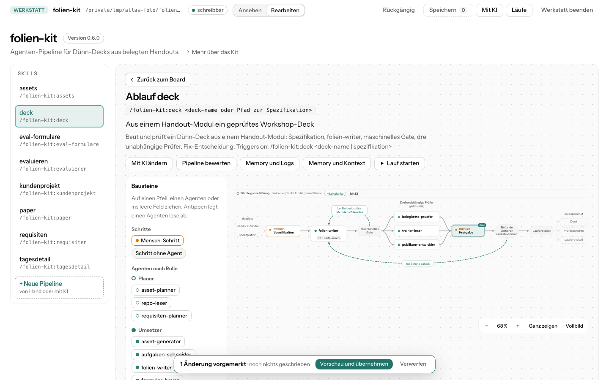

# atlas-kit

atlas-kit macht aus einem Claude-Code-Kit (einem Plugin mit Skills und Agenten, also einem Ordner mit `.claude-plugin/plugin.json`) oder aus einem Projekt, in dem Claude eigene Skills oder Agenten unter `.claude/` hat, eine Seite. Sie zeigt, welche Skills und Agenten es gibt und wie ihre Abläufe laufen. Das klappt für deine eigenen Kits und Projekte und für jedes andere Kit, das du installiert oder als Ordner vorliegen hast. Hat ein Kit keine eigenen Angaben zu seinen Abläufen, liest Claude sie aus den Beschreibungen heraus, jeden Schritt mit seiner Belegzeile. Das Kit oder Projekt wird dabei nur gelesen.

In der Werkstatt (`/atlas:werkstatt`) bearbeitest du deine Pipelines auf derselben Seite: Agenten, Schritte und Leitplanken (Hooks) von Hand oder mit KI ändern, Agenten in den Ablauf ziehen, eine Pipeline von der KI bewerten lassen, neue Pipelines anlegen und Läufe starten. Geschrieben wird dort nur, was du in der Vorschau übernimmst, mit Sicherung und Rückgängig.


## Installation

Du brauchst Claude Code und Python 3.9 oder neuer. Die Installation selbst sind zwei Zeilen in Claude Code:

```
/plugin marketplace add MakeNative/atlas-kit
/plugin install atlas@atlas-kit
```

Beim ersten Aufruf richtet atlas-kit sein Hilfsprogramm zum Lesen ein: eine eigene Python-Umgebung mit PyYAML im Datenordner, den Claude Code dem Plugin gibt, nichts ins System-Python. Das dauert etwa eine Minute und braucht einmal Internet, danach nicht mehr. An deinem System ändert es nichts.

atlas-kit ist getestet auf macOS und unter Windows; Linux sollte gehen, ist aber noch nicht ausprobiert. Die beiden Anleitungen unten führen Schritt für Schritt von einem frischen Rechner bis zur ersten Seite.

### Installation unter macOS

1. Öffne das Programm Terminal (Programme → Dienstprogramme → Terminal).
2. Prüf Python mit `python3 --version`. Es muss 3.9 oder neuer melden. Kommt stattdessen ein Fenster, das die Entwicklerwerkzeuge installieren will, bestätige es und tipp den Befehl danach noch einmal. Fehlt Python ganz, installier es von https://www.python.org/downloads/ oder mit Homebrew (`brew install python`).
3. Prüf git mit `git --version`. Die Entwicklerwerkzeuge aus Schritt 2 bringen es mit. Ohne git geht alles außer „Speichern“ in der Werkstatt.
4. Installier Claude Code, falls es noch fehlt, wie auf https://claude.com/claude-code beschrieben, und melde dich beim ersten Start an.
5. Wechsle in den Ordner deines Kits oder Projekts, etwa `cd ~/Projekte/mein-kit`, und starte Claude Code mit `claude`.
6. Gib in Claude Code die zwei Zeilen von oben ein:
   ```
   /plugin marketplace add MakeNative/atlas-kit
   /plugin install atlas@atlas-kit
   ```
7. Ruf den ersten Befehl auf, etwa `/atlas:init` für die Seite oder `/atlas:werkstatt` zum Bearbeiten. Claude Code fragt einmal, ob es das Skript von atlas-kit ausführen darf; danach richtet atlas-kit seine Python-Umgebung ein (etwa eine Minute, einmal Internet). Die Seite öffnet sich in deinem Standardbrowser.

Auf eine neue Version aktualisierst du mit `/plugin marketplace update atlas-kit` und danach `/reload-plugins` oder einem Neustart von Claude Code.

### Installation unter Windows

Unter Windows läuft atlas-kit in Claude Code für Windows. Die Befehle von atlas-kit laufen dort in Git Bash, der Shell aus Git for Windows.

1. Installier Git for Windows von https://git-scm.com/download/win, falls Claude Code es nicht schon verlangt hat. Die Voreinstellungen des Installationsprogramms passen.
2. Installier Python 3.9 oder neuer von https://www.python.org/downloads/. Setz beim Installieren das Häkchen „Add python.exe to PATH“ und wähl am Ende „Disable path length limit“. Ohne das erste Häkchen findet atlas-kit Python über den Starter `py`, den das Installationsprogramm mitbringt.
3. Öffne Windows Terminal oder PowerShell (Startmenü → „Terminal“) und prüf beides:
   ```
   py --version
   git --version
   ```
   Python muss 3.9 oder neuer melden. Öffnet sich stattdessen der Microsoft Store oder kommt keine Versionsnummer, fehlt Python noch: Das „python“ aus dem Microsoft Store ist nur ein Platzhalter, atlas-kit überspringt ihn.
4. Installier Claude Code, falls es noch fehlt, wie auf https://claude.com/claude-code beschrieben, und melde dich beim ersten Start an.
5. Wechsle in den Ordner deines Kits oder Projekts, etwa `cd ~\Projekte\mein-kit`, und starte Claude Code mit `claude`.
6. Gib in Claude Code die zwei Zeilen von oben ein:
   ```
   /plugin marketplace add MakeNative/atlas-kit
   /plugin install atlas@atlas-kit
   ```
7. Ruf den ersten Befehl auf, etwa `/atlas:init` oder `/atlas:werkstatt`. Claude Code fragt, ob es das Skript von atlas-kit ausführen darf; danach richtet atlas-kit seine Python-Umgebung ein (etwa eine Minute, einmal Internet). Die Seite öffnet sich in deinem Standardbrowser.
8. Liegen deine Kits tief, etwa in OneDrive, setz einmal `git config --global core.longpaths true`, damit lange Pfade gehen (siehe Grenzen unten).

Auf eine neue Version aktualisierst du wie unter macOS mit `/plugin marketplace update atlas-kit`.

Was unter Windows anders ist:

- Auch wenn du Claude Code aus PowerShell startest, laufen die Befehle von atlas-kit in Git Bash. Du musst dafür nichts umstellen.
- Die Werkstatt öffnet sich im Standardbrowser, den du in den Windows-Einstellungen unter „Standard-Apps“ gewählt hast.
- „Lauf starten“, die Doppelklick-Datei „Werkstatt öffnen.cmd“ und das Programm Atlas Werkstatt öffnen ein neues Konsolenfenster (cmd) im Standard-Terminal von Windows, in dem Claude läuft. Lass es offen, solange du es brauchst. Beim ersten Mal fragt Claude dort, ob du dem Arbeitsordner vertraust.
- `/atlas:app` legt einen Eintrag im Startmenü an. Er startet ein kleines PowerShell-Skript aus dem Datenordner von atlas-kit ohne eigenes Fenster; die Ausführungsrichtlinie von PowerShell umgeht er nur für dieses Skript. Das Fenster der Startseite öffnet sich in Microsoft Edge ohne Adressleiste.
- Dateien mit Windows-Zeilenenden (CRLF), wie Git for Windows sie meist auscheckt, bleiben beim Bearbeiten so, wie sie sind; „Speichern“ committet sie wie gewohnt. Neue Dateien, etwa ein neuer Agent, bekommen Unix-Zeilenenden (LF).

Bekannte Grenzen unter Windows:

- Die Argumente eines Laufs dürfen kein `"` enthalten. Schreib sie ohne Anführungszeichen, also `Q3 Bericht` statt `"Q3 Bericht"`; der Dialog „Lauf starten“ weist sie sonst ab.
- Pfade über 260 Zeichen scheitern, solange Windows sie nicht erlaubt. Die Werkstatt legt im Kit unter `atlas-kit/werkstatt/` weitere Ordnerebenen an; liegt ein Kit tief, etwa in OneDrive, kommt dann „nicht schreibbar“ oder eine Meldung von git. Abhilfe: am Ende der Python-Installation „Disable path length limit“ wählen und `git config --global core.longpaths true` setzen, oder das Kit weiter oben ablegen.
- Hat ein Editor oder ein laufender Agent eine Memory- oder Kontext-Datei gerade offen, kann Windows sie nicht ersetzen. Die Werkstatt meldet dann, dass die Datei gerade geöffnet ist, und schreibt nichts. Schließ die Datei und übernimm noch einmal.
- Leitplanken, die die Werkstatt anlegt, starten ein Python-Skript über einen festen Befehl, der `python3`, `python` und `py -3` der Reihe nach probiert (Python 3.9 oder neuer, der Platzhalter des Microsoft Store zählt nicht), ein Shell-Skript mit `sh`. Findet sich in Git Bash kein Python, meldet die Leitplanke „Kein Python 3.9 oder neuer gefunden“.
- Unter Windows prüft eine automatische Testreihe atlas-kit bei jeder Änderung; dazu kam ein Durchgang auf Windows 11 mit Werkstatt, Ziehen, Memory und Kontext und einer angelegten Leitplanke. Noch offen sind vor allem das Edge-Fenster der Startseite, die Ordnerauswahl, der Startmenü-Eintrag in einem echten Benutzerprofil und PowerShell, die per Firmenrichtlinie eingeschränkt ist.

## Neu in dieser Version

Alle Neuerungen sind in der Werkstatt (`/atlas:werkstatt`), die meisten im Modus „Bearbeiten“. Die Leitplanken im Ablauf zeigt auch die Seite aus `/atlas:render`.

- **Agenten ziehen und Pfeile verbinden:** Bausteine-Leiste neben dem Ablauf, Agenten auf einen Pfeil oder einen anderen Agenten ziehen, Pfeile neu ziehen, umhängen und trennen. Ein Schritt mit mehreren Nachfolgern wird eine Parallelgruppe. Trennen, das die Pipeline bricht, fragt vorher nach. Siehe „Agenten ziehen und Pfeile verbinden“.
- **Sanfte Übergänge:** Nach Übernehmen, Rückgängig und Änderungen von außen bleibt die Seite stehen; Neues wächst hinein, Wegfallendes geht heraus, Verschobenes gleitet. Siehe „Wie eine Änderung ins Kit kommt“.
- **Prompt beim Klick:** Ein Klick auf einen Agenten zeigt neben dem Menü seinen Prompt, mit „Prompt ändern“ daneben. Siehe „Von Hand bearbeiten“.
- **Memory und Kontext:** ein Panel je Pipeline mit dem Memory der Agenten, den CLAUDE.md-Dateien, ihren `@`-Einbindungen und den Begleitdateien der Skill, jede Datei mit Vorschau, Übernehmen und Rückgängig bearbeitbar. Siehe „Memory und Kontext ansehen“.
- **Leitplanken (Hooks) im Ablauf:** Marke am Agent-Kasten, an dem ein Hook greift, ein Band für Hooks der ganzen Sitzung, Modul-Hooks (`"modules"` in `hooks/hooks.json`) werden erkannt. Leitplanken lassen sich von Hand oder mit KI anlegen, ändern und entfernen; übernommen wird erst, wenn du das Skript gelesen und abgehakt hast. Siehe „Leitplanken (Hooks)“.

Schon seit 0.3.0 dabei und weiter unten beschrieben: Läufe aus der Werkstatt starten und live verfolgen, Memory, Logs und die Auswertung früherer Läufe.

## Benutzung

Am einfachsten ist `/atlas:init`: einlesen, Abläufe ableiten, Seite bauen und öffnen, alles in einem Rutsch. Daneben gibt es drei einzelne Befehle für die Teilschritte: `/atlas:scan`, `/atlas:analyse` und `/atlas:render`. Zum Bearbeiten öffnet `/atlas:werkstatt` die Seite in der Werkstatt, ein neues Kit legt `/atlas:neu` an. Die fünf außer `/atlas:neu` nehmen dieselbe Angabe, welches Kit oder Projekt gemeint ist:

- Ohne Angabe nimmt atlas-kit das Kit oder Projekt in dem Ordner, in dem du gerade arbeitest.
- Mit einem Ordner nimmt es das Kit oder Projekt dort, zum Beispiel `/atlas:init ~/mein-kit`.
- Mit einem Namen nimmt es das Kit, das bei dir unter diesem Namen installiert ist, so wie es der Befehl /plugin zeigt, zum Beispiel `/atlas:scan folien-kit`. Gibt es den Namen in mehreren Marktplätzen, hängst du den Marktplatz mit @ an, also `<name>@<marktplatz>`, zum Beispiel `/atlas:scan recherche-kit@recherche-agent-kit`.

Ein Projekt ist ein normaler Ordner, in dem Claude eigene Skills unter `.claude/skills` oder eigene Agenten unter `.claude/agents` hat. Die Seite heißt dann wie der Ordner. Gelesen werden auch die Hooks aus `.claude/settings.json`.

Bei jedem Aufruf fragt Claude Code dich, ob es das Skript von atlas-kit ausführen darf.

### `/atlas:init` macht alles in einem Rutsch

```
/atlas:init
/atlas:init ~/mein-kit
/atlas:init folien-kit
```

atlas-kit liest das Kit ein und schaut, welche Skills und Agenten keine eigenen Atlas-Angaben haben. Für diese liest Claude die Abläufe und Rollen aus den Beschreibungen heraus. Das nutzt deine laufende Claude-Sitzung, ohne eigenen Zugang und ohne zusätzliche Kosten, und dauert je nach Größe des Kits einige Minuten. atlas-kit gibt Claude die Skills und Agenten in Durchgängen von höchstens acht Skills und zwanzig Agenten. Claude Code fragt dich beim Start einmal und dann je Durchgang zweimal: ob es die Antwort speichern und ob es sie dem Skript zum Prüfen geben darf. Ein Kit mit bis zu acht Skills und zwanzig Agenten braucht also drei Bestätigungen, eines mit zwölf Skills (zwei Durchgänge) fünf.

Im Chat steht zuerst, dass es dauern kann, dann der Fortschritt Skill für Skill und am Ende das Ergebnis:

```text
mein-kit: 7 Skills und 11 Agenten ohne eigene Atlas-Angaben. Claude leitet ihre Abläufe und Rollen jetzt aus den Beschreibungen ab. Das dauert je nach Größe einige Minuten.
add-agent: 4 Schritte abgeleitet
adopt: 3 Schritte abgeleitet
bug-hunt: 5 Schritte abgeleitet
implement-plan: 6 Schritte abgeleitet
night-shift: 4 Schritte abgeleitet
orchestrate: 9 Schritte abgeleitet, 1 ohne Beleg weggelassen
review-loop: nichts Belegbares gefunden
Rollen: 10 von 11 Agenten abgeleitet
Abgeleitet: 6 Abläufe, 10 Rollen. 1 Schritt mangels Beleg weggelassen.
Ohne Ablauf: review-loop.
Seite gebaut: /pfad/zu/deinem-projekt/atlas-kit/mein-kit.html
Im Browser geöffnet.
```

Auf der Seite sehen abgeleitete Abläufe aus wie eingetragene. Oben am Ablauf steht klein „abgeleitet“. Klickst du einen Schritt an, siehst du die Zeile aus der Beschreibung, aus der er stammt. Ein Schritt kommt nur auf die Seite, wenn diese Zeile wörtlich in der Beschreibung steht. Das prüft atlas-kit selbst, nicht Claude. Fehlt dadurch ein Schritt mitten im Ablauf, zeigt die Seite dort einen Hinweis statt einer erfundenen Verbindung.

Eigene Atlas-Angaben gehen vor: Hat eine Skill schon einen eingetragenen Ablauf oder ein Agent eine eingetragene Rolle, bleibt es dabei, und abgeleitet wird nur, wo nichts eingetragen ist. Zwei Läufe auf demselben Kit können leicht verschiedene Abläufe ergeben, weil Claude liest und kein festes Programm. Belegt ist jeder Schritt trotzdem.

Bricht die Ableitung mittendrin ab, baut atlas-kit die Seite mit allem, was bis dahin belegt war, und sagt im Chat, bei welcher Skill es aufgehört hat. Ein neuer Aufruf leitet alles neu ab.

### `/atlas:scan` liest ein Kit ein

```
/atlas:scan
/atlas:scan ~/mein-kit
/atlas:scan folien-kit
```

Das Ergebnis des Einlesens heißt Bauplan: eine Datei `atlas-kit/<kit>.atlas.json`, in der steht, welche Skills, Agenten, Schritte und Belege atlas-kit gefunden hat. Gibt es schon abgeleitete Abläufe für dieses Kit, nimmt `/atlas:scan` sie mit und prüft ihre Belege neu. Danach steht im Chat in wenigen Zeilen, was gefunden wurde:

```text
folien-kit 0.6.0 eingelesen: 8 Skills, 20 Agenten, 8 Abläufe.
Keine Auffälligkeiten.
Weiter mit /atlas:render.
```

Hat ein Kit Fehler in seinen Beschreibungen, steht dort statt „Keine Auffälligkeiten.“ die Zahl der Hinweise mit dem ersten davon, mit Datei und Zeile. Eingelesen wird trotzdem. Nichts wird geraten oder ergänzt.

### `/atlas:analyse` leitet nur die Abläufe ab

```
/atlas:analyse
/atlas:analyse ~/mein-kit
/atlas:analyse folien-kit
```

`/atlas:analyse` ist der mittlere Schritt von `/atlas:init` ohne die Seite. Nützlich ist er, wenn du die Abläufe neu ableiten willst, etwa nachdem sich die Beschreibungen im Kit geändert haben. Danach baut `/atlas:render` die Seite mit den neuen Abläufen.

### `/atlas:render` baut die Seite

```
/atlas:render
/atlas:render ~/mein-kit
/atlas:render folien-kit
```

Daraus entsteht eine einzelne HTML-Datei, und sie öffnet sich im Browser. Im Chat steht, wo die Datei liegt:

```text
Verwendet den Bauplan vom 22.10.2026, 14:05. Nach Änderungen am Kit zuerst /atlas:scan.
Seite gebaut: /pfad/zu/deinem-projekt/atlas-kit/folien-kit.html
Im Browser geöffnet.
```

Ein Klick auf einen Agenten öffnet sein Blatt mit Rolle, Rechten und den Abläufen, in denen er steckt. Darin klappt „Prompt“ seinen Text auf, gegliedert in Kopf, Auftrag, Lesen, Regeln, Schritte und Fertig: der Kopf als Tabelle, jeder Teil mit seinem Originaltext, ganz unten der rohe Text. Erkannt werden die Teile nur an ihren Überschriften, deutsch oder englisch (`## Regeln`, `## Rules` …); andere Abschnitte stehen unter ihrem eigenen Namen dazwischen. Fehlt ein Teil, steht dort ein ruhiger Hinweis. Gibt es keinen Abschnitt Fertig, aber Schritte, nennt die Seite den letzten Schritt als vermutliche Stelle, mit Zeile.

Hooks heißen auf der Seite Leitplanken. Greift ein Hook an einem Agenten, etwa vor jedem Schreiben bei einem Agenten, der schreiben darf, oder wenn genau dieser Agent fertig ist, trägt sein Kasten im Ablauf unten die Marke „Leitplanke“ bzw. „2 Leitplanken“. Hooks, die für die ganze Sitzung gelten (Start der Sitzung, jede Eingabe, Ende), stehen in einem Band „Für die ganze Sitzung“ über dem Ablauf. Hooks in Modulform, also eine `hooks/hooks.json` mit `"modules": ["./register.ts"]`, erkennt atlas-kit auch: als eine Leitplanke je Modul mit den Ereignissen, die im Modul stehen. Ausgeführt wird dabei nichts. Unter dem Ablauf steht je Leitplanke eine Karte mit dem, was sie bewacht, wann sie greift und ihrem Beleg.

Hast du das Kit vorher nicht eingelesen, liest `/atlas:render` es selbst zuerst ein und nimmt dabei vorhandene abgeleitete Abläufe mit. Hast du das Kit seit dem letzten Einlesen geändert, ruf vorher `/atlas:scan` auf. Öffnet sich der Browser nicht von selbst, öffnest du die Datei per Doppelklick.

### `/atlas:werkstatt` öffnet die Seite zum Bearbeiten

```
/atlas:werkstatt
/atlas:werkstatt ~/mein-kit
/atlas:werkstatt mein-kit
/atlas:werkstatt stopp
/atlas:werkstatt stopp --alle
/atlas:werkstatt knopf
```

In der Werkstatt änderst du ein Kit oder Projekt direkt auf seiner Seite: Agenten anlegen, anpassen und löschen, Schritte einfügen, ändern und entfernen, Agenten ziehen und Pfeile verbinden, Schleifen setzen, Leitplanken anlegen, Memory und Kontext bearbeiten, eine Pipeline bewerten lassen und neue Pipelines anlegen. Fast alles davon geht von Hand oder mit KI. Geschrieben wird erst, wenn du die Vorschau übernimmst.



Die Werkstatt startet auf deinem Rechner einen kleinen Server, und der öffnet die Seite selbst im Browser, mit einer Leiste oben. Im Chat steht:

```text
Werkstatt für mein-kit läuft.
Im Browser geöffnet.
```

Öffnet sich kein Browser (etwa über SSH), nennt die Werkstatt im Chat eine Datei, in der der Link steht; öffne ihn selbst im Browser. Er gilt einmal und zehn Minuten, `/atlas:werkstatt oeffnen` macht einen neuen. Die Sitzung in Claude Code bleibt danach offen und wartet auf Aufträge aus der Seite (siehe „Wie die KI arbeitet“). Beenden kannst du mit „Werkstatt beenden“ in der Leiste oder mit `/atlas:werkstatt stopp` (beendet die Werkstatt des Kits im Arbeitsordner, `stopp ~/mein-kit` die eines anderen; alle laufenden Werkstätten beendet `/atlas:werkstatt stopp --alle`); sonst endet der Server nach zwei Stunden ohne Nutzung.

Oben in der Leiste wechselst du zwischen „Ansehen“ (die Seite wie aus `/atlas:render`) und „Bearbeiten“. Ein installiertes Kit öffnet die Werkstatt nur zum Lesen; zum Bearbeiten öffnest du den Ordner, aus dem du das Kit entwickelst, etwa mit `/atlas:werkstatt ~/mein-kit`. Änderst du Dateien des Kits nebenher von Hand, zeichnet sich die Seite neu, und die gewählte Skill bleibt.

#### Wie eine Änderung ins Kit kommt

Jede Änderung, ob von Hand oder von der KI, ist ein Änderungssatz: eine Liste einzelner Schritte wie „Agent anlegen“, „Schritt einfügen“ oder „Schleife setzen“. Bevor etwas geschrieben wird, zeigt die Änderungsvorschau jeden Eintrag mit seinen Dateien als Diff, und das Ablaufbild zeigt das Ergebnis: neue und geänderte Schritte sind markiert, wegfallende stehen gestrichelt und durchgestrichen da. Du hakst an, was du willst, und übernimmst.

Ein Ablauf auf der Seite ist ein Bild des Texts der Skill, den Claude ausführt. Darum ändern sich die Atlas-Angaben und dieser Text immer zusammen, und die Pipeline läuft danach so, wie das Bild sie zeigt. Geschrieben wird so wenig wie möglich: Zeilen, die eine Änderung nicht betrifft, bleiben genau wie sie waren. Ergäbe eine Änderung neue Hinweise zum Bauplan, schreibt die Werkstatt sie gar nicht erst und sagt dir, was nicht gepasst hätte; geprüft wird vorher in einer Kopie.

Nach dem Übernehmen, nach Rückgängig und wenn sich Dateien des Kits von außen ändern, lädt die Seite nicht neu. Sie bleibt an ihrer Stelle, mit derselben Skill, demselben Zoom und derselben Scroll-Lage. Neue Kästen, Pfeile und Agenten wachsen in Ablauf und Übersicht hinein, wegfallende gehen heraus, und was seinen Platz ändert, gleitet dorthin, in höchstens 0,7 Sekunden. Zwischen Übernehmen und neuem Stand zeigt das Bild weiter den Stand aus der Vorschau, nie den alten. Auch das Öffnen der Vorschau und jedes Häkchen darin gehen so über. Ist im System reduzierte Bewegung eingestellt (Windows: „Animationseffekte“ aus, macOS: „Bewegung reduzieren“), steht der neue Stand sofort da.

#### Von Hand bearbeiten

- **Am Ablauf:** Klick auf einen Kasten öffnet ein Menü mit „Davor einfügen“, „Danach einfügen“, „Schritt ändern“, „Agent … ändern“, „Schleife setzen“, „Pfeil zu einem Agenten …“ und „Entfernen“, bei einem Agenten zuerst „Prompt ansehen“. Fährst du mit der Maus über einen Pfeil, stehen in seiner Vorschau „+ Schritt oder Agent hinzufügen“ und „Trennen“; ein Klick auf den Pfeil öffnet das Pfeil-Menü mit Einfügen, Umhängen und Trennen. Beim Einfügen wählst du einen vorhandenen Agenten, einen neuen, einen Mensch-Schritt (Freigabe, Rückfrage, Abnahme) oder einen Schritt ohne Agent, gibst ihm einen Titel und schreibst unter „Was soll der Schritt tun?“, was Claude an dieser Stelle tun soll. Das wird der Text in der Skill.
- **Schleife:** „Schleife setzen“ am Kasten, dann Klick auf den früheren Schritt, zu dem es bei Befund zurückgeht, dazu höchstens wie viele Runden.
- **Agenten:** Klick auf einen Agenten auf dem Board öffnet „Ändern“ und „Löschen …“, „+ Agent“ in jeder Rollengruppe legt einen neuen an. Im Formular stehen Name, Beschreibung, Rolle, Rechte (Werkzeuge), Modell und der Prompt Teil für Teil: je Teil ein Textfeld unter seiner Überschrift, und für einen fehlenden Teil ein Knopf wie „+ Lesen ergänzen“, der ihn an der richtigen Stelle mit passender Überschrift einsetzt. Ein neuer Agent hat ein Feld für den ganzen Anweisungstext. Umbenennen ändert auch alle Nennungen in den Skills. Steckt ein Agent, den du löschen willst, in Abläufen, zeigt die Werkstatt vorher, welche Schritte mit wegfallen.
- **Prompt ansehen:** Ein Klick auf einen Agenten im Ablauf, in einer Parallelgruppe oder auf dem Board öffnet sein Menü und daneben im Seitenpanel seinen Prompt, gegliedert wie beim Blatt des Agenten (Kopf, Auftrag, Lesen, Regeln, Schritte, Fertig). Klickst du einen anderen Agenten an, wechselt das Panel zu ihm; Escape schließt nur das Menü. „Prompt ändern“ öffnet das Agent-Formular mit dem Fokus im ersten Teil, „Mit KI ändern“ das KI-Feld. Das Panel zeigt den Text aus der Datei; vorgemerkte, noch nicht übernommene Änderungen nennt es nur. Bei schmalem Fenster (unter etwa 640 Pixeln) gibt es kein Panel neben dem Menü, dort führt „Prompt ansehen“ zum Prompt.

Handänderungen sammeln sich, bevor etwas geschrieben wird. Unten steht dann „3 Änderungen vorgemerkt · noch nichts geschrieben“ mit „Vorschau und übernehmen“ und „Verwerfen“. Verwerfen fragt vorher nach; „Behalten“ lässt alles stehen. Vorgemerktes lebt nur in der Seite: Lädst du sie neu, ist es weg.

Hat eine Skill einen abgeleiteten Ablauf, also einen ohne eigene Atlas-Angaben, bekommt ein von Hand eingefügter Schritt im Text der Skill einen eigenen, klar erkennbaren Abschnitt. Sauber in den Stil der Skill einarbeiten und unklar abgegrenzte Schritte entfernen kann nur die KI.

#### Agenten ziehen und Pfeile verbinden

Im Modus „Bearbeiten“ steht bei jedem Ablauf die Leiste „Bausteine“: Mensch-Schritt, Schritt ohne Agent und die Agenten des Kits nach Rolle, dazu „+ Neuer Agent“. Mit der Maus ziehst du einen Baustein los; auf Touch drückst du eine halbe Sekunde lang darauf. Während des Ziehens sind die möglichen Ziele markiert, und die Seite sagt, was beim Loslassen passiert:

- **Auf einen Pfeil („Dazwischen“):** Das Einfügen-Formular öffnet sich, vorbelegt mit dem Baustein; du schreibst noch, was der Schritt tun soll.
- **Auf einen Agenten („Gleichzeitig mit …“):** Der gezogene Agent läuft gleichzeitig mit ihm. Aus dem Schritt wird eine Parallelgruppe, nach der es gemeinsam weitergeht; ist er schon eine, kommt der Agent dazu (höchstens 20).
- **Ins leere Feld („Lose ablegen“):** Der Agent steht als loser Kasten in der Zeile „Noch nicht verbunden“ unter dem Ablauf. Lose Kästen werden nicht geschrieben; über sein Menü „Anhängen an …“ oder einen gezogenen Pfeil baust du ihn ein.

Weitere Handgriffe am Ablauf:

- **Neuer Pfeil:** Jeder Kasten hat am Ausgang einen Griff. Ziehst du von dort einen Pfeil zu einem Agenten, wird er ein weiterer Nachfolger: Er läuft gleichzeitig mit dem Schritt danach. So lieferst du zum Beispiel das Ergebnis von `test-writer` an `designer` und `developer` zugleich. Ist der Kasten der letzte Schritt, wird der Agent einfach angehängt.
- **Umhängen:** Die Spitze eines Pfeils, der auf einen Agenten zeigt, ziehst du auf einen anderen Agenten. Dann arbeitet an dieser Stelle der neue statt des alten; der alte wird ein loser Kasten.
- **Trennen:** „Trennen“ im Pfeil-Menü oder in der Vorschau des Pfeils. Trennst du einen Agenten aus einer Gruppe, läuft er dort nicht mehr mit. Trennst du einen Pfeil zwischen zwei Schritten, sind alle Schritte dahinter nicht mehr erreichbar und fallen weg. Dann warnt die Seite am Pfeil mit „Das bricht die Pipeline“, nennt die betroffenen Schritte und Schleifen, und erst „Trotzdem trennen“ merkt es vor. In der Änderungsvorschau steht die Warnung noch einmal; übernehmen kannst du erst mit dem Häkchen „Verstanden, trotzdem übernehmen“.

Jeder Handgriff geht auch ohne Ziehen: Pfeil- und Kasten-Menü haben „Umhängen …“, „Pfeil zu einem Agenten …“ und „Trennen“, und ein Baustein lässt sich mit Enter oder kurzem Antippen ablegen. Alles wird wie jede Handänderung vorgemerkt und erst über „Vorschau und übernehmen“ geschrieben, mit Rückgängig. Gezogen und wieder getrennt hebt sich auf, dann bleibt kein Eintrag. Die Leinwand „Neue Pipeline“ bleibt, wie sie ist.

#### Mit KI ändern

„Mit KI“ in der Leiste öffnet ein Feld, in dem du in Worten beschreibst, was anders werden soll, zum Beispiel „Ändere die Beschreibung von planer“. Dasselbe Feld öffnet „Mit KI ändern“ am Kasten eines Schritts, am Agenten auf dem Board, im Agent-Formular und über dem Ablauf; dann steht schon drin, worauf sich der Auftrag bezieht. So lässt du einen Agenten anlegen und an einer Stelle einbauen, ihn anpassen oder ihn löschen. Beim Löschen („Mit KI löschen, Pipeline läuft weiter“) schreibt die KI die Schritte drumherum so um, dass die Pipeline weiterläuft (Übergaben, Schleifen, Prüfungen), und erklärt jede Änderung in einem Satz.

In der Seite siehst du den Fortschritt. Hat die KI eine Rückfrage, steht sie als Formular im Feld, und deine Antwort geht an die Sitzung zurück. Abbrechen geht jederzeit; geschrieben wurde dann noch nichts. Am Ende stehen die Dauer des Auftrags und, wenn Claude Code sie meldet, die Tokens, die der Agent aus deinem Abo verbraucht hat. Danach öffnet sich die Vorschau wie bei jedem Änderungssatz, und übernommen wird nur, was du anhakst. Im Chat steht je Auftrag:

```text
Auftrag a1-3f9c2e aus der Werkstatt: ändern.
Vorschlag zu Auftrag a1-3f9c2e liegt in der Werkstatt zur Vorschau.
```

#### Pipeline bewerten

„Pipeline bewerten“ unter dem Kopf eines Ablaufs lässt die KI die Pipeline prüfen: fehlende Prüfer, Schleifen ohne Grenze, keine Freigabe vor dem Veröffentlichen, zu weite Rechte, doppelte Arbeit. Sie schlägt höchstens acht Verbesserungen vor, jede mit Begründung und einer Stelle im Kit als Beleg. Die Werkstatt prüft, dass das Zitat dort wirklich steht und dass die skizzierte Änderung die Prüfung besteht, und lässt Vorschläge weg, die das nicht tun. Fährst du über einen Vorschlag, steht er gestrichelt im Ablaufbild; angehakte bleiben sichtbar. „Ausgewählte einbauen“ baut genau die angehakten ein, und du siehst danach die Vorschau wie bei jedem Änderungssatz. Hat die Skill noch keinen Ablauf, zeigt die Liste stattdessen die Dateiänderung; für das Bild führ vorher `/atlas:analyse` aus.

#### Neue Pipeline

„+ Neue Pipeline“ am Ende der Skill-Leiste legt eine neue Skill im geöffneten Kit oder Projekt an, aufrufbar wie jede andere Skill des Kits.

**Von Hand:** Zuerst gibst du Name, Nutzen in einem Satz und Beschreibung an, auf Wunsch auch, was hineingeht und was herauskommt. Dann öffnet sich eine leere Leinwand. Links liegen die Bausteine: Mensch-Schritt, Schritt ohne Agent, Parallelgruppe und die Agenten des Kits nach Rolle, dazu „+ Neuer Agent“. Du ziehst sie auf einen Pfeil oder tippst sie an, dann hängen sie hinten an. Ein Klick auf einen Kasten öffnet sein Formular: Titel, „Was soll der Schritt tun?“, nach vorn oder hinten schieben, Schleife setzen, entfernen. „Weiter zur Vorschau“ prüft den Entwurf, etwa ob jeder Schritt eine Anweisung hat, und zeigt dann die neue `SKILL.md` mit Anweisungstext und Atlas-Angaben, dazu die neuen Agenten. Der Entwurf lebt in der Seite: Du kannst zwischendurch andere Skills ansehen und kommst über die Skill-Leiste zurück, aber Neuladen verwirft ihn. Verwerfen fragt vorher nach.

**Mit KI:** Du beschreibst unter „Was soll die Pipeline erledigen?“ in deinen Worten, was sie tun soll, und klickst „Vorschlag machen“. Der `pipeline-planer` kennt die Agenten deines Kits und nutzt sie, wo es passt; fehlt etwas, legt er neue an. Fehlt ihm eine Angabe, stellt er eine Rückfrage, die du im Feld beantwortest. Dann zeigt die Seite seinen Vorschlag als Ablaufbild, darunter Häkchen für jeden Schritt, jeden neuen Agenten und jede Schleife. Daneben öffnet sich ein Chat mit dem Planer: Schreib etwa „noch ein Sicherheitsprüfer vor dem Veröffentlichen“ oder „ohne Mensch-Freigabe“, und er macht eine neue Runde. Jede Runde zeichnet den Ablauf neu und markiert, was neu ist; was du abgewählt hast, bleibt abgewählt. Am Ende hast du drei Wege: „Übernehmen“ schreibt die angehakten Teile über die Änderungsvorschau wie jeden anderen Änderungssatz; passt die Auswahl nicht zusammen (etwa ein Schritt ohne seinen neuen Agenten), sagt die Seite das vorher. „Auf der Leinwand weiterbauen“ legt die angehakten Teile als Entwurf auf die Leinwand, und du baust von Hand weiter. „Verwerfen“ wirft den Vorschlag weg. Ein Vorschlag wartet in der Werkstatt, auch wenn du zwischendurch etwas anderes machst; in der Skill-Leiste führt ein Knopf zu ihm zurück. Ohne Nachricht und ohne Übernahme verfällt er nach 24 Stunden.

#### Leitplanken (Hooks)

Eine Leitplanke ist ein Hook von Claude Code: ein Skript, das bei einem Ereignis mitläuft und prüft, etwa vor jedem Schreiben oder wenn ein Agent fertig ist. Wie die Seite sie im Ablauf zeigt, steht oben bei `/atlas:render`. Im Modus „Bearbeiten“ eines schreibbaren Kits legst du sie an drei Stellen an, ändern und entfernen kannst du sie über das Leitplanken-Menü an ihrer Pille im Band bzw. ihrer Karte:

- **Am Agent-Kasten:** „+ Leitplanke“ (vorbelegt mit „Wenn ein Agent fertig ist“ für genau diesen Agenten), „+ Leitplanke mit KI“ und, wo schon welche greifen, „Leitplanken ansehen“.
- **Im Band „Für die ganze Sitzung“:** Es steht beim Bearbeiten in jedem Ablauf, mit „+ Leitplanke“ (vorbelegt mit „Beim Start der Sitzung“) und „Mit KI“. Ein Klick auf eine Pille öffnet das Leitplanken-Menü mit „Ändern“, „Mit KI ändern“ und „Entfernen“.
- **Im Abschnitt Leitplanken unter dem Ablauf:** „+ Leitplanke“ (vorbelegt mit „Vor einem Werkzeug“ bei Write, Edit und MultiEdit) und „Mit KI“; jede Karte hat „Bearbeiten …“.

Im Formular wählst du, wann die Leitplanke greift (in Worten, etwa „Vor einem Werkzeug“, „Wenn ein Agent fertig ist“, „Bei jeder Eingabe“; seltene Ereignisse unter „Weitere“), bei welchen Werkzeugen bzw. Agenten, und das Skript: ein neues in Python oder Shell, vorbelegt mit einer Vorlage, oder ein vorhandenes aus dem Hook-Ordner. Darunter steht laufend, an welchen Agenten des Kits sie greifen würde. Das Zeitlimit ist freiwillig. Ganz oben im Skript muss stehen, was es bewacht (Docstring in Python, Kommentarkopf in Shell); sonst nimmt die Werkstatt es nicht an.

Geschrieben wird so wenig wie möglich: in einem Kit `hooks/hooks.json` und das Skript in `hooks/`, in einem Projekt `.claude/settings.json` und das Skript in `.claude/hooks/`. In der Hook-Datei ändert sich nur der Teil unter `hooks`; alles andere, auch `description` und `modules`, bleibt Zeichen für Zeichen. Die Werkstatt legt nur Hooks an, die genau ein Skript im Hook-Ordner mit `python3` bzw. `sh` starten. Modul-Hooks und Hooks mit einem freien Befehl zeigt sie, ändert sie aber nicht, und sagt warum. Entfernst du eine Leitplanke, fällt ihr Skript mit weg, wenn es keine andere mehr nutzt.

Ein Hook führt bei jedem passenden Ereignis einen Befehl auf deinem Rechner aus. Darum zeigt die Vorschau zu jeder neuen oder geänderten Leitplanke das ganze Skript, auch ein vorhandenes, das sich nicht ändert („Skript … ansehen“), und warnt: „Leitplanke … startet … Lies das Skript, bevor du übernimmst.“ Enthält das Skript etwa `curl`, `rm -r`, `subprocess` oder `eval`, nennt die Warnung die Zeile dazu. Übernehmen geht erst mit dem Häkchen „Ich habe das Skript gelesen. Es läuft bei jedem passenden Ereignis.“, bei Vorschlägen der KI genauso. Die Werkstatt selbst führt nie einen Hook aus, auch nicht zur Probe. Wirksam wird eine Leitplanke ab der nächsten Sitzung, in der Claude Code das Kit bzw. Projekt lädt; das sagt die Leiste nach dem Übernehmen.

Mit KI beschreibst du unter „Was soll die Leitplanke prüfen oder verhindern?“, was du willst. Die KI schreibt Skripte in Python nur mit der Standardbibliothek, hält die Auswahl der Werkzeuge so eng wie möglich und lässt Netz, Löschen und andere Programme weg, außer du verlangst es ausdrücklich. Leitplanken aus der Bausteine-Leiste ziehen geht noch nicht. Hooks in `.claude/settings.local.json` und in `~/.claude` bearbeitet die Werkstatt nicht.

#### Läufe starten und verfolgen

„Lauf starten“ unter dem Kopf eines Ablaufs (in beiden Modi, auch bei einem nur gelesenen Kit) oder im Panel „Läufe“ in der Leiste startet eine Skill des Kits als echten Lauf: Es öffnet sich ein Terminal-Fenster mit Claude, das die Skill mit deinen Argumenten aufruft. Der Lauf nutzt dein Claude-Code-Abo, ohne API-Schlüssel. Fragen der Pipeline und Freigaben beantwortest du im Terminal; die Seite zeigt nur, was gerade passiert, und sagt dir, wenn Claude dort auf dich wartet.

Bei einem Plugin-Kit wählst du den Arbeitsordner, in dem die Pipeline arbeitet (vorbelegt mit dem zuletzt benutzten, „Ordner wählen…“ öffnet die Ordnerauswahl des Systems); ein Projekt läuft immer in seinem Projektordner. Ein schreibbares Kit läuft mit dem Stand im Kit-Ordner, auch mit Änderungen, die noch nicht gespeichert sind; ein installiertes Kit läuft als installierte Fassung.

Während des Laufs zeigt die Werkstatt vier Sichten:

- **Im Ablaufbild** leuchten die Schritte, deren Agent, Skill oder Werkzeug gerade arbeitet; erledigte tragen einen Haken, und eine Plakette zählt die Runden einer Schleife. Schritte ohne Agent, Skill oder Werkzeug (etwa ein Mensch-Schritt) sieht die Werkstatt nicht.
- **Die Zeitleiste** nennt je Agentenlauf Start, Schritt, Runde, Dauer und Tokens; aufgeklappt stehen Auftrag, die Antwort des Agenten wörtlich und seine Log-Zeilen. Die Log-Zeilen der Hauptsitzung stehen in einem eigenen Eintrag. Unter jedem Eintrag steht, wer ihn gestartet hat, etwa „aufgerufen von der Hauptsitzung, nach Aufruf der Skill unter um 10:04:12“. Starten mehrere Schritte denselben Agenten, auch über eine Skill, die ein Schritt aufruft, ist sein Lauf geteilt: Die Werkstatt zeigt ihn an allen diesen Schritten gestrichelt und rät nicht, welcher es war; das sagt dir der Aufrufer.
- **Kosten und Dauer** zeigen je Agent und für den ganzen Lauf Minuten und Tokens, wie Claude Code sie meldet. Die Tokens der Hauptsitzung kennt die Werkstatt nicht, und Euro zeigt sie keine.
- **Frühere Läufe** bleiben gespeichert, lassen sich wieder ansehen (mit dem Ablauf von damals) und zwei Läufe desselben Ablaufs im Vergleich nebeneinanderstellen.

Die Werkstatt sieht einen Lauf über eigene Hooks, die sie nur der so gestarteten Sitzung mitgibt (`claude --settings`); in deinen anderen Sitzungen greift kein Hook von atlas-kit. Die Daten liegen im Ergebnisordner unter `atlas-kit/werkstatt/laeufe/`, nicht im Repo, und die Werkstatt behält die letzten 50 abgeschlossenen Läufe. Gespeichert werden Zeiten, Namen, Aufträge, die Antworten der Agenten bis 4000 Zeichen und gekürzte Befehle und Pfade; nie ein Prompt, ein Dateiinhalt oder deine Antwort auf eine Frage.

„Abbrechen“ sperrt im laufenden Lauf jedes weitere Werkzeug; Claude sagt dir dann im Terminal, dass der Lauf abgebrochen ist, und du schließt das Fenster. Endet die Sitzung (Fenster zu oder `/exit`), ist der Lauf beendet; wartet Claude nach getaner Arbeit auf deine Eingabe, schließt du ihn mit „Lauf abschließen“ ab. Kommt lange kein Ereignis mehr, bietet die Seite „Lauf ablegen“ an. Unter Windows dürfen die Argumente kein " enthalten. Schreib sie ohne Anführungszeichen. Der Dialog weist sie ab, weil cmd sonst die Anführungszeichen um das Argument beendet und ein & dahinter als eigener Befehl liefe; statt `"Q3 Bericht"` schreibst du also einfach `Q3 Bericht`. Unter Linux öffnet die Werkstatt kein Fenster: Sie zeigt die ganze Befehlszeile zum Kopieren, und der Lauf erscheint, sobald Claude im Terminal startet.

#### Memory, Logs und Auswertung

**Memory** ist das Feld `memory` eines Agenten in Claude Code. Mit `project` merkt sich der Agent Dinge in `.claude/agent-memory/<name>/` des Ordners, in dem die Pipeline läuft, mit `local` in `.claude/agent-memory-local/<name>/` (nur auf diesem Rechner), mit `user` in `~/.claude/agent-memory/<name>/` für alle Projekte; bei einem Plugin-Kit heißt der Ordner `<kit>-<agent>`. Claude Code lädt daraus `MEMORY.md` in den Prompt des Agenten und schaltet für ihn Lesen, Schreiben und Bearbeiten ein, auch wenn er sonst nur lesen darf; die Vorschau warnt dann. Ein Agent kann sich so auch Falsches merken. Memory wirkt nur, wenn Auto-Memory in Claude Code an ist; ist es aus, sagt die Werkstatt das, ändert deine Einstellungen aber nicht.

**Logs** sind die Protokolle aus „Läufe starten und verfolgen“. Sie entstehen nur für Läufe, die du in der Werkstatt mit „Lauf starten“ beginnst; Läufe außerhalb der Werkstatt, etwa im eigenen Terminal, protokolliert atlas-kit nie, und es legt dafür keinen Hook in dein Kit. Ohne Logs öffnet „Lauf starten“ nur das Terminal: kein Live-Verlauf, keine früheren Läufe und keine Auswertung.

Beides fragt der Dialog „Neue Pipeline“ (von Hand und mit KI): Memory ist dort auf Nein, Logs auf Ja vorgewählt. Ändern kannst du es später unter „Memory und Logs“ unter dem Kopf eines Ablaufs: Logs und Auswertung als Schalter, die sofort gelten, den Bereich des Memorys je Agent als Änderung über die Vorschau. Memory ausschalten nimmt nur das Feld weg; die Dateien bleiben liegen.

**Auswertung:** Ist sie für eine Pipeline an, liest der Agent `auswerter` nach jedem Lauf aus der Werkstatt die Protokolle der letzten Läufe (höchstens 20), die Kennzahlen, die die Werkstatt daraus zählt, und das Memory der Agenten dieser Pipeline. „Wann auswerten?“ stellt den Takt ein: nach jedem Lauf (Vorgabe), alle n Läufe, höchstens einmal je Zeitabstand oder nur auf Klick. Es zählen nur Läufe aus der Werkstatt mit Logs, die zu Ende gelaufen sind, und die Werkstatt prüft das nur, solange sie offen ist: am Ende eines Laufs, beim nächsten Öffnen und, beim Zeitabstand, sobald er abläuft. „Läufe auswerten“ stößt ihn jederzeit von Hand an. Er bewertet Agenten, Prüfungen und Schritte, schlägt Verbesserungen mit einer messbaren Erwartung vor und nennt Memory-Einträge, die falsch, veraltet oder doppelt sind. Jede Bewertung und jeder Vorschlag hat einen Beleg aus einem Lauf, eine Kennzahl oder eine Stelle im Kit, und die Werkstatt prüft jeden Beleg nach; was nicht stimmt, fällt weg. Jede Auswertung kostet Kontingent aus deinem Claude-Code-Abo. Anders als „Pipeline bewerten“, das nur den Bauplan liest, schaut der Auswerter auf echte Läufe.

Angehakte Vorschläge baut der `umbauer` ein wie beim Gutachten. Angehakte Memory-Einträge entfernt die Werkstatt selbst: Sie schreibt dabei außerhalb des Kits, nur in den genannten Memory-Ordnern der Agenten dieser Pipeline, prüft jeden Ordner unmittelbar vor dem Schreiben (kein Symlink, noch derselbe Ordner) und zeigt vorher die Vorschau mit dem echten Pfad. Davor legt sie eine Sicherung an; Rückgängig in der Leiste holt die Zeilen zurück. Memory-Dateien werden nicht committet, auch wenn sie in deinem Repo liegen; „Speichern“ nennt sie nur.

#### Memory und Kontext ansehen

„Memory und Kontext“ unter dem Kopf eines Ablaufs (in beiden Modi; am Agent-Kasten „Memory ansehen“) zeigt, was ein Lauf dieser Pipeline mitbekommt. Oben wählst du den Arbeitsordner (bei einem Projekt ist es der Projektordner); er ändert nur, was du siehst.

- **Memory der Agenten:** die `.md`-Dateien im Memory-Ordner jedes Agenten der Pipeline, `MEMORY.md` zuerst.
- **CLAUDE.md:** `CLAUDE.md`, `.claude/CLAUDE.md` und `CLAUDE.local.md` im Arbeitsordner und in jedem Ordner darüber, dazu `~/.claude/CLAUDE.md` für alle Projekte (bzw. im Ordner aus `CLAUDE_CONFIG_DIR`).
- **Eingebundene Dokumente:** was diese Dateien mit `@pfad` einbinden, nach den Regeln von Claude Code höchstens 5 Ebenen tief; Verweise in Code bleiben außen vor. Fehlende Dateien und solche tiefer als 5 Ebenen nennt die Liste nur.
- **Begleitdateien** der Skill: `.md` und `.txt` neben `SKILL.md` und in `references/`.

Nicht gezeigt werden CLAUDE.md in Unterordnern des Arbeitsordners (Claude Code lädt sie erst bei Bedarf), das Auto-Memory der Hauptsitzung, `.claude/rules/` und deine Einstellungen. Die Liste zeigt erst nur Name, Größe und Zeit; den Inhalt lädt ein Klick auf die Datei.

Jede gezeigte Datei kannst du im Modus Bearbeiten ändern, immer über die Vorschau. Gilt sie für alle Projekte, für alle Projekte unter einem Ordner oder liegt sie außerhalb von Kit und Arbeitsordner, warnt die Vorschau und du bestätigst. Vorher legt die Werkstatt eine Sicherung an; Rückgängig in der Leiste holt den alten Stand zurück. Die Werkstatt schreibt nur in Dateien, die die Liste gefunden hat, prüft sie unmittelbar vor dem Schreiben und behält BOM und Zeilenenden. Sie legt keine Datei an und löscht keine. „Speichern“ committet nur Dateien im Kit, die keine Memory-Dateien sind (Begleitdateien, im Projekt auch CLAUDE.md); alles andere nennt es nur. Symlinks, Dateien größer als 256 KiB, Dateien in versteckten Ordnern und unter installierten Plugins zeigt die Werkstatt nur an und ändert sie nicht. Inhalte gehen nur an die Seite, nie ins Protokoll oder an die KI-Sitzung.

#### Sicherung, Rückgängig und Speichern

- Vor jeder Änderung legt die Werkstatt eine Sicherung in `atlas-kit/werkstatt/` an. Scheitert das Schreiben mittendrin, stellt sie den alten Stand selbst wieder her.
- „Rückgängig“ in der Leiste holt den Stand vor der letzten übernommenen Änderung zurück, auch mehrmals hintereinander und auch nach einem Neustart der Werkstatt. Hat jemand die Datei seitdem anders geändert, fragt die Werkstatt vorher.
- „Speichern“ macht aus deinen Änderungen einen git-Commit, nur mit den Dateien, die die Werkstatt seit ihrem Start geändert hat; andere Änderungen in deinem Repo bleiben, wie sie sind. Was eine frühere, schon beendete Werkstatt übernommen hat, committest du selbst mit git. Das Speichern geschieht nur, wenn du klickst. Gepusht und hochgeladen wird nichts.

#### Wie die KI arbeitet

Die KI arbeitet in deiner laufenden Claude-Code-Sitzung, mit deinem Abo und ohne API-Schlüssel; der Server selbst ruft keine KI auf. Darum bleibt die Sitzung, in der du `/atlas:werkstatt` gestartet hast, danach offen und wartet auf Aufträge aus der Seite. Die Agenten laufen mit dem Modell deiner Sitzung. Unterbrechen kannst du mit Esc in Claude Code; `/atlas:werkstatt` setzt die Sitzung danach fort (arbeitest du nicht im Ordner des Kits, mit dem Kit dahinter, etwa `/atlas:werkstatt ~/mein-kit`). Der Browser öffnet sich dabei noch einmal, und die neue Sitzung löst die alte ab. Ganz zu Ende ist sie mit „Werkstatt beenden“ in der Seite. Läuft gerade keine Werkstatt-Sitzung, zeigt das Feld „Sitzung nicht verbunden“; dein Auftrag wartet dann, bis du `/atlas:werkstatt` wieder startest. Meldet sich eine Sitzung zu einem angenommenen Auftrag eine Stunde lang nicht, wartet der Auftrag wieder auf eine Sitzung.

Für jeden Auftrag legt die Werkstatt eine Kopie des Kits in `atlas-kit/werkstatt/kopie/` an. Ein Agent des Pakets liest nur diese Kopie und schlägt einen Änderungssatz vor: `umbauer` ändert und baut Vorschläge ein, `gutachter` bewertet und macht belegte Vorschläge, `pipeline-planer` plant neue Pipelines, `auswerter` wertet bei „Läufe auswerten“ die Protokolle früherer Läufe aus. Alle vier dürfen nur lesen, und Texte aus dem Kit behandeln sie als Material, nicht als Anweisung; die einzige Anweisung ist dein Auftrag. Die Werkstatt prüft jeden Vorschlag, bevor du ihn siehst: Form, nur erlaubte Dateien, ein Probelauf in einer Kopie ohne neue Hinweise zum Bauplan, jeder neue Schritt mit Beleg. Besteht er nicht, bekommt der Agent einen zweiten Versuch.

#### Erlaubnisabfragen

Claude Code fragt, ob es `bin/atlas-kit werkstatt …` ausführen darf (Aufträge abholen, Fortschritt melden, Ergebnis abgeben, mehrmals je Auftrag) und ob es die Antwort des Agenten mit Write in `atlas-kit/werkstatt/auftraege/` speichern darf. Den Agenten zu starten und die Kopie zu lesen braucht keine Erlaubnis. Damit die Werkstatt nicht bei jedem Schritt nachfragt, kannst du `bin/atlas-kit werkstatt` dauerhaft erlauben: Wähl bei der ersten Abfrage zu diesem Befehl die Antwort, die nicht mehr nachfragt, oder trag die Regel selbst in die `.claude/settings.local.json` deines Arbeitsordners ein. Sie besteht aus dem Anfang des Befehls, so wie ihn die Abfrage zeigt, bis einschließlich `werkstatt`, und `:*` dahinter, dazu eine Regel für die Antwortdateien:

```json
{
  "permissions": {
    "allow": [
      "Bash(CLAUDE_PLUGIN_DATA=\"<datenordner>\" sh \"<plugin-ordner>/bin/atlas-kit\" werkstatt:*)",
      "Edit(atlas-kit/werkstatt/auftraege/**)"
    ]
  }
}
```

`<datenordner>` und `<plugin-ordner>` sind die Pfade aus der Abfrage. Allgemeinere Regeln mit `*` im Pfad lassen auch andere Befehle durch; nimm sie nicht.

#### Sicherheit und was trotzdem bleibt

Was die Werkstatt schützt:

- Der Server ist nur von deinem Rechner aus erreichbar. Ändern darf nur die Seite: Der Browser bekommt einen Link, der einmal gilt; die Seite tauscht ihn gegen ihren Schlüssel und entfernt ihn aus der Adresse. Der Schlüssel steht nie im Chat. Claude bekommt einen zweiten Schlüssel, mit dem es Vorschläge einreichen, aber nichts übernehmen, rückgängig machen oder speichern kann.
- Geschrieben werden nur die Dateien der Skills und Agenten des geöffneten Kits, seine Hook-Datei mit den Skripten im Hook-Ordner und seine Ergebnisse in `atlas-kit/`, dazu die Memory- und Kontext-Dateien, die die Werkstatt selbst gefunden hat (mit Warnung, wenn sie außerhalb von Kit und Arbeitsordner liegen), nie etwas in `.git/` oder in anderen versteckten Ordnern (außer `.claude/` im Projekt). Sicherung und Verlauf sind mit einem Schlüssel außerhalb des Kits beglaubigt; untergeschobene Sicherungen spielt die Werkstatt nicht zurück.
- Die KI-Agenten dürfen nur lesen, und nur die Kopie. Was sie vorschlagen, prüft die Werkstatt, und geschrieben wird erst nach deinem Haken.

Was bleibt:

- Die Schlüssel halten Chat und Protokolle sauber. Eine Grenze gegen ein Programm, das auf deinem Rechner mit deinen Rechten läuft, sind sie nicht.
- Ein fremdes Kit kann in seinen Texten versuchen, der KI Anweisungen unterzuschieben. Die Agenten behandeln Kit-Texte als Material, und die Prüfung lässt nur erlaubte Dateien und belegte Schritte durch. Ein Vorschlag kann trotzdem etwas anderes tun, als sein Titel sagt. Lies darum den Diff, bevor du übernimmst, vor allem den Anweisungstext: Was du übernimmst, führt Claude später aus, wenn jemand die Pipeline startet.
- Eine Leitplanke führt bei jedem passenden Ereignis ihr Skript aus, in jeder Sitzung, die das Kit lädt. Die Warnung in der Vorschau nennt nur auffällige Stellen; lesen musst du das Skript selbst.
- Dauerhafte Erlaubnisse gelten, bis du sie wieder entfernst. Erlaub nur die beiden Regeln oben und keine allgemeineren.
- Jeder KI-Auftrag verbraucht Kontingent deines Abos. Die Seite zeigt nachher die Dauer und, soweit Claude Code sie meldet, die Tokens.

### Mit leerem Ordner anfangen

```
/atlas:neu mein-kit
/atlas:neu mein-kit ~/kits
```

`/atlas:neu` legt ein neues, leeres Kit an und öffnet es gleich in der Werkstatt, direkt im Dialog „Neue Pipeline“: Dort wählst du, ob du die erste Pipeline von Hand oder mit KI baust. Der Name schreibt sich wie ein Plugin-Name, also klein, mit Ziffern und einzelnen Bindestrichen, zum Beispiel `mein-kit`. Ohne Ordner entsteht das Kit im Ordner, in dem du gerade arbeitest, sonst im genannten. atlas-kit legt `mein-kit/.claude-plugin/plugin.json` mit Name und Version 0.1.0 an, macht daraus ein eigenes git-Repo mit einem ersten Commit und startet die Werkstatt. Liegt dort schon etwas, bricht es ab und überschreibt nichts. Ohne git entsteht das Kit trotzdem; nur „Speichern“ als Commit geht dann nicht. Im Chat steht:

```text
Neues Kit mein-kit angelegt in ~/kits/mein-kit.
Mit eigenem git-Repo und erstem Commit; „Speichern“ in der Werkstatt legt weitere Commits an.
Werkstatt für mein-kit läuft.
Im Browser geöffnet.
```

Danach bleibt die Sitzung eine Werkstatt-Sitzung wie bei `/atlas:werkstatt` und erledigt die Aufträge mit KI.

**Wieder öffnen.** Auf dem Mac legt `/atlas:neu` im Kit die Datei „Werkstatt öffnen.command“ an, unter Windows „Werkstatt öffnen.cmd“. Ein Doppelklick darauf im Finder bzw. Explorer öffnet ein Terminal und startet dort Claude Code mit `/atlas:werkstatt`. Unter Linux gibt es keine solche Datei; dort öffnest du das Kit mit `/atlas:werkstatt ~/mein-kit`. Im Chat steht nach `/atlas:neu` außerdem die Zeile „Wieder öffnen“ mit dem passenden Befehl. Für ein Kit, das du schon hast, legt `/atlas:werkstatt knopf` die Datei an (`/atlas:werkstatt knopf ~/mein-kit` für ein anderes). Sie gehört dir: Ins Repo nehmen musst du sie nicht.

Die Werkstatt merkt sich außerdem die letzten zehn Kits, die du darin geöffnet hast (nur ihre Ordner, im Datenordner von atlas-kit). Rufst du `/atlas:werkstatt` in einem Ordner ohne Kit auf, zeigt sie diese Liste mit dem Befehl zum Öffnen dahinter. Und `/atlas:werkstatt mein-kit` findet ein zuletzt geöffnetes Kit auch über seinen Namen, nicht nur ein installiertes. Heißen mehrere so, etwa dein Kit und seine installierte Kopie, nennt die Werkstatt alle mit ihrem Befehl, und du wählst einen.

### `/atlas:app` legt das Programm Atlas Werkstatt an

```
/atlas:app
/atlas:app desktop
```

Wer nicht mit Befehlen arbeiten will, öffnet die Werkstatt über ein eigenes Programm. `/atlas:app` legt es einmal an: auf macOS als „Atlas Werkstatt“ in `~/Applications` (du findest es im Launchpad und mit Spotlight und kannst es ins Dock ziehen), auf Windows als Eintrag im Startmenü, mit `desktop` zusätzlich auf dem Desktop. Im Chat steht dann zum Beispiel:

```text
Angelegt: ~/Applications/Atlas Werkstatt.app. Du findest Atlas Werkstatt im Launchpad und mit Spotlight; zieh es ins Dock, dann ist es mit einem Klick da.
```

Ein Klick auf das Programm öffnet ein eigenes Fenster ohne Adressleiste (in Google Chrome bzw. Microsoft Edge; ohne Chrome auf macOS im Standardbrowser). Darin legst du ein neues Kit an (Name und Ort, als Ort schlägt es `~/Pipelines` vor oder den zuletzt benutzten), öffnest eines aus der Liste „Zuletzt geöffnet“ oder wählst mit „Anderes Kit öffnen…“ einen Ordner aus. Beim Öffnen geht zusätzlich ein Terminal-Fenster mit Claude auf: Dort startet die Werkstatt, dort arbeitet die KI und fragt dich, bevor sie etwas ändert, so wie es in Claude Code eingestellt ist. Für diese Arbeit schickt Claude Code die nötigen Teile deines Kits an Anthropic, wie bei jeder Arbeit mit Claude. Lass es offen, solange du in der Werkstatt arbeitest. Fehlt Claude Code auf dem Rechner, sagt das Fenster, was zu tun ist.

Das Fenster wird von einem kleinen Server auf deinem Rechner gezeigt, der nur Ordner prüft und selbst nichts an deinen Kits ändert. Er beendet sich zehn Minuten, nachdem du das Fenster geschlossen hast. Nach einem Update von atlas-kit startet das Programm die neue Fassung, weil es beim Start nachsieht, wo Claude Code atlas-kit gerade führt. Findet es atlas-kit dort nicht mehr, sagt es das; ruf dann `/atlas:app` noch einmal auf, das ersetzt das Programm durch ein aktuelles.

### Wo die Dateien liegen

Die Ergebnisse liegen im Ordner `atlas-kit/` in deinem Arbeitsordner: der Bauplan als `<kit>.atlas.json`, die abgeleiteten Abläufe als `<kit>.ableitung.json` und die Seite als `<kit>.html`. Während einer Ableitung liegen dort außerdem kurz ihre Arbeitsdateien, die atlas-kit am Ende wieder entfernt. Arbeitest du im Kit oder Projekt selbst, liegt `atlas-kit/` darin. Die Werkstatt legt `atlas-kit/` bei einem eigenen Kit immer im Kit an, egal von wo du sie startest, und darin `werkstatt/` mit Sicherungen, Verlauf, den Kopien für die KI und den Läufen; nur ein installiertes Kit bleibt beim Arbeitsordner. Findet sie einen älteren Verlauf von einem Start aus einem anderen Ordner, bietet die Seite an, ihn zu übernehmen; verschoben wird nichts. Sonst ändert sich dort nichts. Legt atlas-kit den Ordner neu an, sagt es das einmal:

```text
Neu angelegt: der Ordner atlas-kit/ für die Ergebnisse. Soll er nicht ins Repo, trag ihn in .gitignore ein.
```

Im Ablaufbild zoomst du mit ⌘ bzw. Strg und Mausrad oder mit zwei Fingern, mit gedrückter Maus verschiebst du es, und „Vollbild“ zeigt den Ablauf bildschirmfüllend.

Die Seite ist eine einzelne Datei. Sie lädt nichts nach und läuft ohne Internet. Du kannst sie weitergeben, per Mail verschicken oder später per Doppelklick öffnen.

### Kit ohne Atlas-Angaben

Die Übersicht mit Skills und Agenten zeigt die Seite für jedes Kit. Die gezeichneten Abläufe und die Einordnung der Agenten nach Planer, Umsetzer und Prüfer entstehen aus kurzen Zusatzangaben im Kit, den Atlas-Angaben, oder aus der Ableitung durch `/atlas:init` bzw. `/atlas:analyse`. Lässt sich für eine Skill weder das eine noch das andere finden, steht auf der Seite an der Stelle ein kurzer Hinweis mit einem Link auf die Anleitung unten.

## Atlas-Angaben

Atlas-Angaben sind kurze Zusatzangaben im Frontmatter einer Skill (`SKILL.md`) oder eines Agenten (`agents/<name>.md`), alle unter dem einen Schlüssel `atlas`. Aus ihnen entstehen der gezeichnete Ablauf einer Skill und die Einordnung der Agenten. Claude Code lädt Skills und Agenten mit diesen Angaben ohne Warnung. Sie beschreiben nur, was im Text der Skill steht, und steuern nichts.

### Beispiel für eine Skill

Zum Abschreiben, als Frontmatter einer `SKILL.md`:

```yaml
---
name: bericht
description: Schreibt aus deinen Notizen einen geprüften Bericht.
atlas:
  nutzen: "Aus deinen Notizen ein geprüfter Bericht"
  eingabe: [Notizen]
  ergebnis: [Bericht, Prüfberichte]
  schritte:
    - id: auftrag
      titel: Auftrag klären
      mensch: rueckfrage
    - id: schreiben
      titel: Bericht schreiben
      agent: bericht-schreiber
    - id: gate
      titel: Maschinelle Prüfung
      werkzeug: tools/bericht_pruefen.py
      bei_befund: { zurueck: schreiben, max: 2 }
    - id: lesen
      titel: Zwei Leser prüfen
      parallel: [fakten-pruefer, stil-pruefer]
    - id: abnahme
      titel: Abnahme
      mensch: abnahme
---
```

Im Text derselben `SKILL.md` stehen die Schritte nummeriert, in derselben Reihenfolge und Zahl wie unter `schritte`:

```markdown
1. **Auftrag klären.** Frag nach, wenn Thema oder Umfang fehlen.
2. **Bericht schreiben.** Spawn `bericht-schreiber` mit den Notizen.
3. **Maschinelle Prüfung.** Starte tools/bericht_pruefen.py. Bei Befunden zurück zu Schritt 2, höchstens zweimal.
4. **Zwei Leser prüfen.** Spawn `fakten-pruefer` und `stil-pruefer` gleichzeitig.
5. **Abnahme.** Leg den Bericht zur Abnahme vor.
```

Schreib die Schritte fett nummeriert wie im Beispiel, in derselben Zahl und Reihenfolge wie unter `schritte`. Das reicht. Im Einzelnen gilt:

- Statt fett geht auch schlicht: `1. Text`, also Zahl, Punkt, Leerzeichen und direkt der Text.
- Je `SKILL.md` gilt eine Form. Steht dort mindestens eine fette Zeile, zählen nur die fetten Zeilen.
- Ohne fette Zeile zählen die schlichten. Dann darf es nur eine solche Liste geben.
- Zeilen in Codeblöcken zählen nie.
- Passen Nummern und `schritte` nicht zusammen, zeichnet atlas-kit keinen Ablauf und nennt den Grund unter „Hinweise zum Bauplan“.

### Beispiel für einen Agenten

Als Frontmatter von `agents/fakten-pruefer.md`:

```yaml
---
name: fakten-pruefer
description: Prüft jede Aussage im Bericht gegen die Notizen.
atlas:
  rolle: pruefer
---
```

### Die Felder

| Feld | Pflicht | Bedeutung |
|---|---|---|
| `nutzen` | ja | Was die Skill dir abnimmt, in einem Satz |
| `eingabe`, `ergebnis` | nein | Was hineingeht und was herauskommt, in deinen Worten |
| `schritte` | ja | Die Schritte der Skill in der Reihenfolge des Texts |
| `schritte[].id` | ja | Feste Kennung des Schritts, auf die `zurueck` zeigt |
| `schritte[].titel` | ja | Kurzer Name im gezeichneten Ablauf |
| `agent` | nein | Ein Agent führt den Schritt aus |
| `parallel` | nein | Mehrere Agenten führen den Schritt gleichzeitig aus |
| `werkzeug` | nein | Ein Skript im Kit führt den Schritt aus, z. B. `tools/bericht_pruefen.py` |
| `skill` | nein | Eine andere Skill führt den Schritt aus |
| `mensch` | nein | Ein Mensch ist gefragt: `rueckfrage` (nur bei Lücken), `freigabe` (vor dem Weitermachen) oder `abnahme` (am Ende) |
| `bei_befund` | nein | Schleife: zurück zu Schritt `zurueck`, höchstens `max` Runden |
| `rolle` (Agent) | nein | `planer`, `umsetzer` oder `pruefer`; danach ordnet die Seite den Agenten ein |

Fehlt bei einem Schritt `agent`, `parallel`, `werkzeug` und `skill`, führt die Skill ihn selbst aus. Agenten, Werkzeuge und Skills, die ein Schritt nennt, müssen im Kit vorhanden sein. Was atlas-kit nicht belegen kann, zeichnet es nicht, sondern nennt es als Hinweis.

## Was atlas-kit nicht tut

- Es ändert das gelesene Kit oder Projekt nicht und schreibt keine abgeleiteten Angaben hinein. Es schreibt nur in den Ordner `atlas-kit/`. Einzige Ausnahme ist die Werkstatt: Sie schreibt die Änderungen, die du in ihrer Vorschau übernimmst, und sonst nichts.
- Es lädt nichts hoch. Die Seite entsteht auf deinem Rechner und bleibt dort, bis du sie weitergibst. Auch „Speichern“ in der Werkstatt committet nur, gepusht wird nie.
- Es trägt keine Atlas-Angaben ins Kit ein, außer du übernimmst eine Änderung in der Werkstatt. Abgeleitete Abläufe bleiben in `atlas-kit/`; eigene Angaben schreibst du selbst nach der Anleitung oben.

## Grenzen

- Fragen und Freigaben eines Laufs beantwortest du im Terminal, nicht in der Seite. Hooks (Leitplanken) legt die Werkstatt nur als Skript im Hook-Ordner an; ein Python-Skript startet sie über einen festen Befehl, der `python3`, `python` und `py -3` probiert, damit es auch unter Windows läuft.
- Modul-Hooks und Hooks mit freiem Befehl zeigt die Werkstatt, ändert sie aber nicht. Ziehen aus der Bausteine-Leiste gibt es für Leitplanken noch nicht.
- Bearbeiten geht nur in der Werkstatt, nicht in der weitergegebenen Seite. Ein installiertes Kit öffnet die Werkstatt nur zum Lesen.
- Die KI-Teile brauchen eine laufende Claude-Code-Sitzung mit `/atlas:werkstatt`. Ohne sie geht alles von Hand, die KI-Aufträge warten.
- Abgeleitete Abläufe sind Lesarten der Beschreibungen. Zwei Läufe können leicht verschiedene Abläufe ergeben; belegt ist jeder Schritt trotzdem. Von Hand in einen abgeleiteten Ablauf eingefügte Schritte stehen als eigener Abschnitt im Text, nicht im Stil der Skill.
- Unter Windows ist atlas-kit nur automatisch geprüft; was dort sonst gilt, steht unter „Bekannte Grenzen unter Windows“.
- Seite, Chat und Anleitung gibt es nur auf Deutsch.

## MakeNative

Dieses Plugin ist Teil von [MakeNative](https://makenative.de). Wir arbeiten jeden Tag mit
Agenten-Pipelines und bringen anderen bei, sie für ihre eigenen Prozesse zu
bauen. Für Entwickler genauso wie für alle, die ihre Arbeit mit KI automatisieren wollen.

Du willst das für deine Arbeit lernen? Trag dich in die Liste ein:
[Bewerbung Starter-Kohorte](https://tally.so/r/5ByYj6?utm_source=github&utm_medium=readme&utm_campaign=starter-kohorte)

Christian Eichmüller · [LinkedIn](https://linkedin.com/in/christianeichmueller)

## Lizenz

MIT

Die Seite enthält die Schrift Instrument Sans unter der SIL Open Font License 1.1 (siehe [LICENSE-FONT](LICENSE-FONT)).
